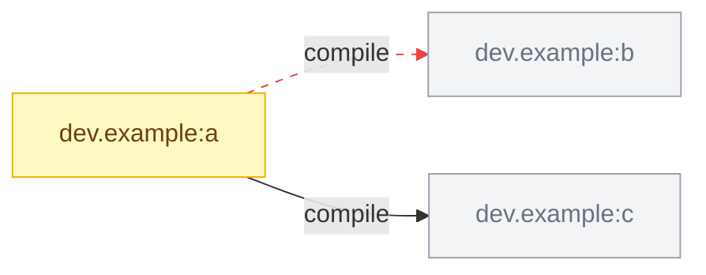

## Module graph changes

| Module | Change |
| --- | --- |
| `dev.example:a` | edge removed `dev.example:b` (compile); edge added `dev.example:c` (compile); dependency `org.example:lib` `1.0.0` -> `2.0.0` |
